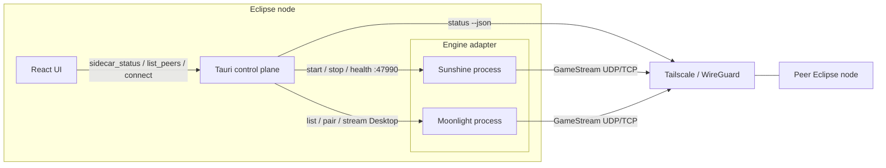
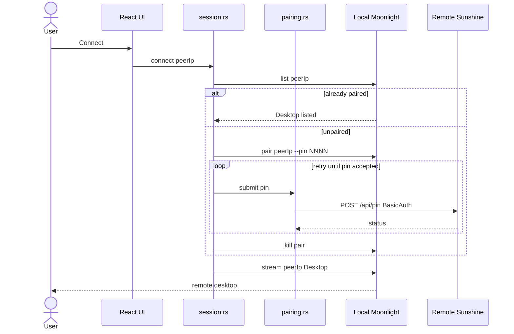
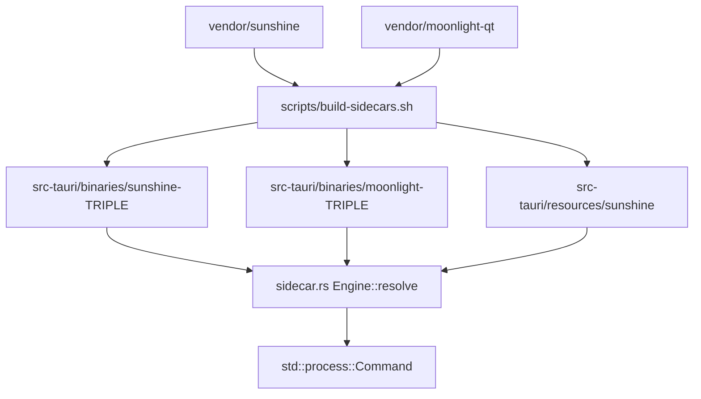

# Architecture Specification: Unified Peer-to-Peer Remote Desktop Node

How to prepare a machine and run the current tree: [User_Guide.md](User_Guide.md) (users) and [Development.md](Development.md) (developers). This document is the product design. Sections marked **Planned** are not in the tree yet.

## Implementation status

Bootstrap as of 2026-08-24, first verified on Omarchy (Arch) Linux with an AMD Radeon 780M (Mesa VA-API encode, not Intel / not CUDA).

| Capability | Status |
| --- | --- |
| Tauri 2 + React 19 + Vite + Tailwind v4 control plane | Implemented (`com.eclipse.app`) |
| Sunshine + Moonlight-Qt as git submodules and Tauri `externalBin` sidecars | Implemented |
| Spawn Sunshine on app start; kill it when the window exits | Implemented |
| Engine adapter (`sidecar.rs`) isolating binary/env/health strings | Implemented |
| Dashboard sidecar status pills | Implemented |
| Submodule SHA pins (`vendor/PINS`) + CI check | Implemented |
| Tailscale peer discovery (`tailscale status --json`) | Implemented |
| Probe peer Sunshine via TCP `:47990` (500ms) | Implemented |
| One-click Connect, automated PIN pairing, spawn Moonlight | Implemented |
| GitHub Actions `.msi` / `.deb` / `.rpm` installers | Planned |
| Windows Sunshine-as-service + `requireAdministrator` | Planned |
| Linux post-install `input` group / udev into `/usr` | Planned |

Vendored pins are recorded in `vendor/PINS`. `scripts/check-pins.sh` and `.github/workflows/check.yml` enforce those SHAs. Do not check out Moonlight tag `v6.1.0` (it does not build against FFmpeg 8).

---

## 1. Project Summary

This project is a high-performance, peer-to-peer remote desktop application designed for secure, zero-latency 60+ FPS desktop control. It combines the hardware-accelerated streaming capabilities of cloud gaming with the zero-config networking of mesh VPNs.

Instead of relying on centralized relay servers (like TeamViewer) or legacy bitmap-based protocols (like VNC), this application leverages **Tailscale** for secure NAT traversal, and orchestrates **Sunshine** (Host) and **Moonlight** (Client) as hidden subsystems.

**User Capabilities:**

* Install a single application on any Windows or Linux machine.
* Open the app to see a live dashboard of their own personal computers (via Tailscale integration).
* Click a single "Connect" button to instantly take control of a remote PC.
* Experience perfectly smooth, hardware-encoded video with sub-16ms input latency.
* Never manually type an IP address, configure a router, or type a pairing PIN.

Until installers exist, "install" means cloning this repository and compiling the control plane plus sidecars (see the user and development guides).

---

## 2. Core Technology Stack

* **App Framework:** Tauri 2 (Rust)
* **Frontend UI:** React + Vite (TypeScript, TailwindCSS)
* **Host Streaming Engine (Bundled Sidecar):** Sunshine (C++)
* **Client Viewing Engine (Bundled Sidecar):** Moonlight-Qt (C/C++). Moonlight-Core via FFI is a v2 option (section 9), not the current engine.
* **Network Transport & Identity:** Tailscale (WireGuard) — OS install is a user prerequisite, not bundled. Discovery (`tailscale status --json` + TCP `:47990`) is implemented; streaming over the tailnet is planned.
* **Streaming Protocol:** Nvidia GameStream (RTSP for handshake, custom UDP for AV/Input)

---

## 3. System Architecture (The Symmetric Node)

The application abandons the traditional "Server vs. Client" application model. Every installation is a **Symmetric Node**.

The Tauri application acts as the "Control Plane" (the brain). It runs in the background and independently manages two "Data Planes" (the muscles):

1. **The Host Subsystem (Sunshine):** Runs silently as a background service, ready to broadcast the screen.
2. **The Client Subsystem (Moonlight):** Spun up on-demand as a borderless window when the user wants to view a remote screen.

This symmetry allows Node A to control Node B, while Node B simultaneously controls Node A, multiplexed over the same Tailscale tunnel.

**Today:** Sunshine is a child of the Eclipse process (not a systemd/Windows service). Moonlight is compiled and bundled but not spawned.

Control plane never links Sunshine or Moonlight as libraries. Engines are processes behind `Engine` in `src-tauri/src/sidecar.rs`. Updating a submodule should change pins, the build script, and `Engine` constants — not React.

---

## 4. Network Management & Discovery

**Implemented.** The application relies on the user already having Tailscale installed on the OS. The Tauri backend wraps the Tailscale CLI in `discovery.rs`. Connect and pairing are implemented in `session.rs` / `pairing.rs`.

### 4.1 Node Discovery

1. On application mount (and Refresh), the Rust backend executes `tailscale status --json`.
2. Rust parses the JSON for authenticated **Peer** entries (not **Self**), hostnames, and Tailscale IPv4 addresses (`100.x` preferred).
3. For each IPv4, Rust TCP-connects to `[PEER_IP]:47990` with a 500ms timeout. Sunshine has no unauthenticated `/api/status`; TCP on the Web UI port is the host-online signal.
4. React receives `{ hostname, ip, hostOnline, tailscaleOnline }[]` plus `tailscaleOk` / `message` when the CLI is missing or not logged in.

### 4.2 Traffic Routing

Because Tailscale acts as a virtual LAN, the application requires **zero NAT traversal logic, zero STUN/TURN servers, and zero port forwarding**. All UDP and TCP traffic is sent to local `100.x.x.x` addresses. The host OS network stack and Tailscale automatically encrypt (via WireGuard) and route the packets.

---

## 5. The Video & I/O Pipeline (GameStream Protocol)

Once a session is established, Tauri gets out of the way. The raw data pipeline is handled entirely by the Sunshine/Moonlight C++ binaries to guarantee zero-copy performance.

### 5.1 Video Pipeline

1. **Host Capture:** Sunshine uses OS-level zero-copy APIs:
   * *Windows:* DXGI Desktop Duplication API.
   * *Linux:* XDG Desktop Portal + PipeWire (DMA-BUF), and compositor-native Wayland grabbers where available (`wlgrab` was used on Hyprland during bootstrap).
2. **Host Encoding:** The raw frame buffer is passed directly to the GPU's hardware encoder (NVENC, AMD AMF, Intel QuickSync, or Linux VA-API) and compressed into an H.264/H.265 (and AV1 where the GPU supports it) packet.
3. **Transport:** Sunshine sends the packet via UDP to the Client over Tailscale.
4. **Client Decoding:** Moonlight receives the packet and uses the Client OS hardware decoder (DXVA2/D3D11VA on Windows, VDPAU/VA-API on Linux).
5. **Client Render:** Moonlight paints the decoded frame directly to an OpenGL/Vulkan/DirectX context.

CUDA is an optional *build* feature for Sunshine on NVIDIA hosts (`ECLIPSE_CUDA=auto|on|off`). Running NVENC does not require compiling with CUDA if the NVIDIA driver already exposes it; the bootstrap machine had no `nvcc` and used VA-API instead.

### 5.2 Input (I/O) Pipeline

1. **Client Capture:** Moonlight captures raw mouse deltas, clicks, and keystrokes using low-level OS hooks (bypassing the React DOM entirely).
2. **Transport:** Input data is sent via a heavily prioritized, encrypted UDP control channel to the Host.
3. **Host Injection:** Sunshine parses the input and injects it into the Host OS:
   * *Windows:* Uses the Win32 `SendInput` API.
   * *Linux:* Uses the kernel-level `uinput` / `evdev` virtual devices. The user must be in the `input` group; local sidecar builds do not install udev rules into `/usr`.

---

## 6. Tauri Sidecar Management

The application bundles Sunshine and Moonlight using Tauri's `externalBin` configuration (`binaries/sunshine`, `binaries/moonlight` plus the Rust host triple). Assets for Sunshine are copied to `src-tauri/resources/sunshine`. Compiled sidecars are gitignored; developers compile them with `scripts/build-sidecars.sh` (or `.ps1`).

Rust talks to engines only through `Engine` (`SUNSHINE`, `MOONLIGHT` in `src-tauri/src/sidecar.rs`): binary name, asset env, health port, start/stop. Tailscale listing lives in `discovery.rs`. PIN HTTP is in `pairing.rs`, Moonlight CLI in `session.rs`.

### 6.1 Process Lifecycle Management

* **Startup (implemented):** When Tauri boots, Rust resolves the Sunshine binary (file named `sunshine` beside the debug exe, else `src-tauri/binaries/sunshine-<HOST_TRIPLE>`). It copies vendored assets to `{exe_dir}/share/sunshine` (the compile-time Windows assets path) and spawns Sunshine with cwd next to the binary. Failure does not abort the UI.
* **Shutdown (implemented):** On `RunEvent::Exit`, Rust kills the Sunshine child.
* **API Control (planned):** Tauri communicates with the local Sunshine instance via its REST API (`https://localhost:47990`) to configure resolution limits, framerates, and encoder preferences based on the user's settings in the React UI.
* **Client Spawning (implemented):** When a connection is requested, Tauri spawns the Moonlight sidecar as `moonlight stream <ip> Desktop`. Pairing runs first if `moonlight list` does not already show Desktop.

---

## 7. Desired User Flow & Auto-Connect Architecture

**Implemented.** One-click Connect bypasses typing a GameStream PIN. Sunshine Web UI Basic Auth uses seeded defaults `eclipse` / `eclipse` when the host has no credentials yet (Tailscale is the security boundary). Custom Sunshine passwords are not prompted for; Connect returns an error.

**The Workflow:**

1. **Select Target:** User clicks **Connect** on a peer row (IP: `100.x.x.x`) in the React UI.
2. **Already paired?** Rust runs `moonlight list <ip>`. If `Desktop` is listed, skip to launch.
3. **Client PIN:** Rust generates a 4-digit PIN and spawns `moonlight pair <ip> --pin NNNN` so the GameStream handshake exists on the host.
4. **The API Handshake (Automated Pairing):**
   * Tauri `POST`s `https://{ip}:47990/api/pin` with JSON `{"pin":"NNNN","name":"Eclipse"}` (Sunshine's field is `name`).
   * TLS accepts Sunshine's self-signed certificate. CSRF is skipped (no `Origin`/`Referer`).
   * Basic Auth is `eclipse`:`eclipse`. The POST is retried until Sunshine reports `status: true` (the handshake must already be open).
5. **Launch Stream:** Tauri executes `moonlight stream <ip> Desktop`. Moonlight connects without a PIN screen.

---

## 8. Build, Packaging, and Distribution

**Today:** local scripts. `scripts/bootstrap.sh` / `bootstrap.ps1` ready the toolchain; `scripts/build-sidecars.sh` / `build-sidecars.ps1` compile sidecars; `npm run tauri dev` runs the app. There is no GitHub Actions installer matrix yet.

**Planned:** a CI pipeline that produces native installers encapsulating the Tauri app, frontend assets, Rust binary, and C++ sidecars.

### 8.1 Repository Structure

* `/docs`: Architecture spec, user guide, development guide.
* `/scripts`: System bootstrap and sidecar build (Linux and Windows).
* `/src`: React + Vite frontend.
* `/src-tauri`: Rust backend, `tauri.conf.json`, capabilities.
* `/src-tauri/binaries`: Target-specific sidecars (gitignored), e.g. `sunshine-x86_64-unknown-linux-gnu`.
* `/src-tauri/resources/sunshine`: Copied Sunshine web/shader assets.
* `/src-tauri/resources/sunshine-prefix`: Local CMake install prefix (gitignored).

* `/vendor/sunshine`, `/vendor/moonlight-qt`: Git submodules pinned in `vendor/PINS`.

### 8.2 Windows Packaging (`.msi` / `.exe`) — planned

* **Compiler:** MSVC (Microsoft Visual C++).
* **Output:** Tauri generates a WiX Toolset `.msi` installer.
* **Permissions:** The installer includes an Application Manifest requesting `requireAdministrator` execution level. This is critical: Sunshine *must* be installed as a Windows Service to allow the application to capture the Windows Lock Screen and bypass UAC prompts.

### 8.3 Linux Packaging (`.deb` / `.rpm` / `AppImage`) — planned

* **Compiler:** Ubuntu latest runner (plus Arch/Fedora as needed).
* **Dependencies:** `src-tauri/tauri.conf.json` already lists a first cut of deb depends (`libwebkit2gtk-4.1-0`, `libgtk-3-0`, `libayatana-appindicator3-1`, `librsvg2-2`, `libavcodec60`, `libva2`, `pipewire`, `libwayland-client0`, Qt 6, SDL2). These must be kept in sync with actual sidecar linkage.
* **Output:** Native `.deb` and `.rpm` packages; AppImage if Qt can be bundled reliably.
* **Permissions:** A post-install script runs to configure `/dev/uinput` permissions (adding the user to the `input` group) so Sunshine can inject mouse movements without running as root.

---

## 9. Future Extensibility

* **Custom Video Canvas:** In v2, rip out the Moonlight-Qt executable. Instead, bind the `moonlight-common-c` library directly into the Rust backend via FFI. Pass the decoded video frames directly to a `<canvas>` element in the React frontend using WebGPU, allowing the remote desktop to run *inside* the React dashboard rather than as a separate window.
* **Wake-on-LAN:** Integrate a Rust UDP broadcast to send Magic Packets over the Tailscale network, allowing the UI to wake up sleeping nodes before attempting to connect.
