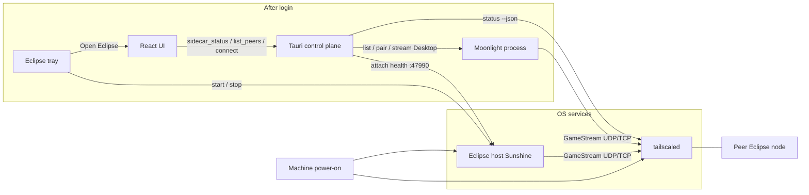
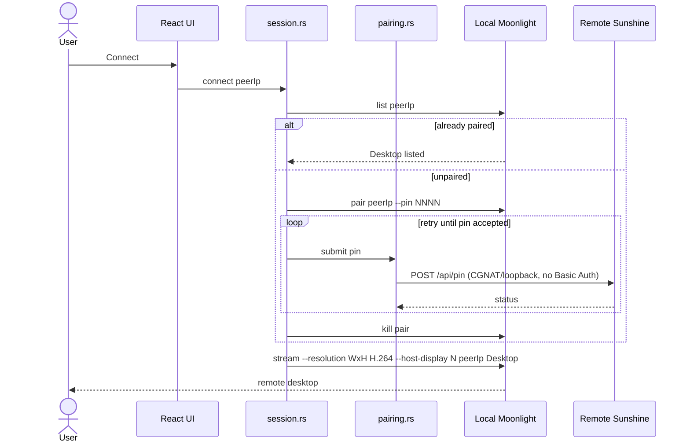
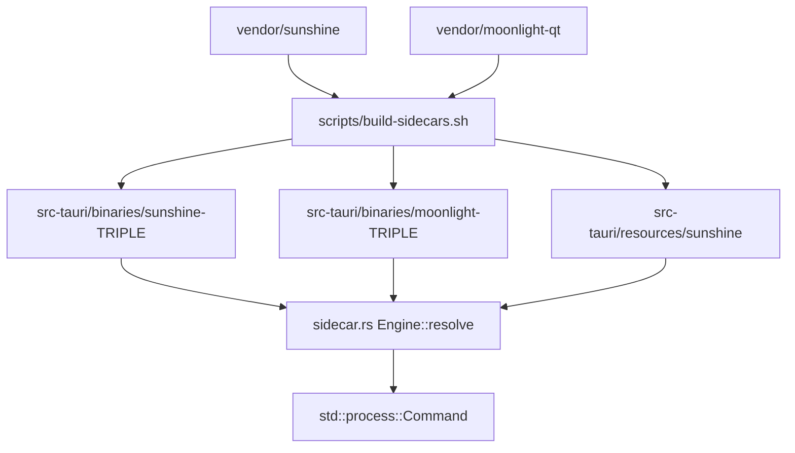

# Architecture Specification: Unified Peer-to-Peer Remote Desktop Node

How to prepare a machine and run the current tree: [User_Guide.md](User_Guide.md) (users), [Development.md](Development.md) (developers), and [Video.md](Video.md) (capture/encode/smoke). This document is the product design. Sections marked **Planned** are not in the tree yet.

## Implementation status

Bootstrap as of 2026-08-24, first verified on Omarchy (Arch) Linux with an AMD Radeon 780M (Mesa VA-API encode, not Intel / not CUDA).

| Capability | Status |
| --- | --- |
| Tauri 2 + React 19 + Vite + Tailwind v4 control plane | Implemented (`com.eclipse.app`) |
| Sunshine + Moonlight-Qt as git submodules and Tauri `externalBin` sidecars | Implemented |
| Spawn Sunshine on app start; kill it when the window exits | Packaged installs attach to the boot-time host service. Source/`tauri dev` spawn a child; **Quit Eclipse** kills that child. Close hides to the tray |
| Eclipse tray (Host streaming on/off) | Implemented. Login autostart (`--tray`). Toggle stops/starts the service without disabling it at boot |
| Engine adapter (`sidecar.rs`) isolating binary/env/health strings | Implemented |
| Dashboard sidecar status pills | Implemented |
| Submodule SHA pins (`vendor/PINS`) + CI check | Implemented |
| Tailscale peer discovery (`tailscale status --json`) | Implemented |
| Probe peer Sunshine via TCP `:47990` (500ms) | Implemented |
| One-click Connect, automated PIN pairing, spawn Moonlight | Implemented |
| Host UI when this PC is being streamed to (disable Connect, force disconnect) | Implemented |
| GitHub Actions `.msi` / `.deb` / `.rpm` installers | Planned (local `scripts/package.sh` / `package.ps1` implemented) |
| Windows `SunshineService` (sunshinesvc, delayed-auto) | Implemented. GUI does not request `requireAdministrator` |
| Linux `eclipse-host.service` at `multi-user.target` | Implemented (`postinst` / Arch `eclipse.install` enable `--now`) |
| Linux post-install `input` group / udev into `/usr` | Package `postinst` / Arch `eclipse.install`. Source helper: `scripts/linux-host-perms.sh` |

Vendored pins are recorded in `vendor/PINS`. `scripts/check-pins.sh` and `.github/workflows/check.yml` enforce those SHAs. Do not check out Moonlight tag `v6.1.0` (it does not build against FFmpeg 8).

---

## 1. Project Summary

This project is a high-performance, peer-to-peer remote desktop application designed for secure, zero-latency 60+ FPS desktop control. It combines the hardware-accelerated streaming capabilities of cloud gaming with the zero-config networking of mesh VPNs.

Instead of relying on centralized relay servers (like TeamViewer) or legacy bitmap-based protocols (like VNC), this application leverages **Tailscale** for secure NAT traversal, and orchestrates **Sunshine** (Host) and **Moonlight** (Client) as hidden subsystems.

**User Capabilities:**

* Install a single application on any Windows or Linux machine.
* Open the app to see a live dashboard of their own personal computers (via Tailscale integration).
* Click a single "Connect" button to instantly take control of a remote PC.
* Experience perfectly smooth, hardware-encoded video with sub-16ms input latency.
* Never manually type an IP address, configure a router, or type a pairing PIN.

Until GitHub Releases exist, install by building a package on that OS (`scripts/package.sh` / `package.ps1`) or compiling from source (see the user and development guides).

---

## 2. Core Technology Stack

* **App Framework:** Tauri 2 (Rust)
* **Frontend UI:** React + Vite (TypeScript, TailwindCSS)
* **Host Streaming Engine (Bundled Sidecar):** Sunshine (C++)
* **Client Viewing Engine (Bundled Sidecar):** Moonlight-Qt (C/C++). Moonlight-Core via FFI is a v2 option (section 9), not the current engine.
* **Network Transport & Identity:** Tailscale (WireGuard) — OS install is a user prerequisite, not bundled. Discovery (`tailscale status --json` + TCP `:47990`) is implemented; streaming over the tailnet is planned.
* **Streaming Protocol:** Nvidia GameStream (RTSP for handshake, custom UDP for AV/Input). Stream size is Native, Half, or Quarter of the host display’s physical current mode (`--resolution WxH`, H.264). Default is Native. Eclipse does not change the host desktop mode.

---

## 3. System Architecture (The Symmetric Node)

The application abandons the traditional "Server vs. Client" application model. Every installation is a **Symmetric Node**.

The Tauri application acts as the "Control Plane" (the brain). It runs in the background and independently manages two "Data Planes" (the muscles):

1. **The Host Subsystem (Sunshine):** Runs silently as a background service, ready to broadcast the screen.
2. **The Client Subsystem (Moonlight):** Spun up on-demand as a borderless window when the user wants to view a remote screen.

This symmetry allows each install to host and view. When this PC is being streamed to, Connect is disabled until the inbound client is disconnected (or force-disconnected from **CLIENT**).

**Today:** Packaged installs run Sunshine as a boot-time OS service. After login, an Eclipse tray can start/stop that service without disabling it at boot. Closing the window hides to the tray; **Quit Eclipse** leaves the host service running. Source trees and `tauri dev` still spawn a Sunshine child (the tray toggle controls that child).

Control plane never links Sunshine or Moonlight as libraries. Engines are processes behind `Engine` in `src-tauri/src/sidecar.rs`. Updating a submodule should change pins, the build script, and `Engine` constants — not React.

---

## 4. Network Management & Discovery

**Implemented.** The application relies on the user already having Tailscale installed on the OS. The Tauri backend wraps the Tailscale CLI in `discovery.rs`. Connect and pairing are implemented in `session.rs` / `pairing.rs`.

### 4.1 Node Discovery

1. On application mount (and Refresh), the Rust backend executes `tailscale status --json`.
2. Rust parses the JSON for authenticated **Peer** entries (not **Self**), hostnames, and Tailscale IPv4 addresses (`100.x` preferred).
3. For each IPv4, Rust TCP-connects to `[PEER_IP]:47990` with a 500ms timeout. Sunshine has no unauthenticated `/api/status`; TCP on the Web UI port is the host-online signal.
4. React receives `{ hostname, ip, hostOnline, tailscaleOnline }[]` plus `tailscaleOk` / `message` when the CLI is missing or not logged in.

### 4.2 Traffic Routing

Because Tailscale acts as a virtual LAN, the application requires **zero NAT traversal logic, zero STUN/TURN servers, and zero port forwarding**. All UDP and TCP traffic is sent to local `100.x.x.x` addresses. The host OS network stack and Tailscale automatically encrypt (via WireGuard) and route the packets.

---

## 5. The Video & I/O Pipeline (GameStream Protocol)

Once a session is established, Tauri gets out of the way. The raw data pipeline is handled entirely by the Sunshine/Moonlight C++ binaries to guarantee zero-copy performance.

### 5.1 Video Pipeline

1. **Host Capture:** Sunshine uses OS-level zero-copy APIs. Capture stays on **auto** (do not force `capture = kms` in-repo).
   * *Windows:* DXGI Desktop Duplication API.
   * *Linux:* `wlr` / `wlgrab` on Hyprland and other wlroots compositors; XDG Desktop Portal + PipeWire on GNOME/KDE; DRM/KMS as a fallback when the Sunshine binary has `CAP_SYS_ADMIN` (see [Video.md](Video.md)).
2. **Host Encoding:** The raw frame buffer is passed directly to the GPU's hardware encoder (NVENC, AMD AMF, Intel QuickSync, or Linux VA-API) and compressed into an H.264/H.265 (and AV1 where the GPU supports it) packet.
3. **Transport:** Sunshine sends the packet via UDP to the Client over Tailscale.
4. **Client Decoding:** Moonlight receives the packet and uses the Client OS hardware decoder (DXVA2/D3D11VA on Windows, VDPAU/VA-API on Linux).
5. **Client Render:** Moonlight paints the decoded frame directly to an OpenGL/Vulkan/DirectX context. Fullscreen is borderless desktop mode with integer-scale letterboxing (never stretched pixels).

Host display inventory is `GET /api/displays` on Sunshine `:47990`. Each stream window can select a host output (`--host-display`); Sunshine runs one capture+encode pipeline per output. Audio plays on the primary window only.

In-stream shortcuts are **Ctrl+Alt** (consumed in Moonlight, not sent to the host; Shift is reserved for Sunshine’s F1–F12 display switch):

| Shortcut | Action |
| --- | --- |
| Ctrl+Alt+Esc | Close every client window and disconnect (quit the host Desktop app) |
| Ctrl+Alt+F | Toggle letterboxed fullscreen on this window |
| Ctrl+Alt+1–9 | Retarget this window to host display N |
| Ctrl+Alt+0 | Open one client window per host display |
| Ctrl+Alt+Q | Close this window; last window disconnects |

CUDA is an optional *build* feature for Sunshine on NVIDIA hosts (`ECLIPSE_CUDA=auto|on|off`). Running NVENC does not require compiling with CUDA if the NVIDIA driver already exposes it; the bootstrap machine had no `nvcc` and used VA-API instead.

### 5.2 Input (I/O) Pipeline

1. **Client Capture:** Moonlight captures raw mouse deltas, clicks, and keystrokes using low-level OS hooks (bypassing the React DOM entirely).
2. **Transport:** Input data is sent via a heavily prioritized, encrypted UDP control channel to the Host.
3. **Host Injection:** Sunshine parses the input and injects it into the Host OS:
   * *Windows:* Uses the Win32 `SendInput` API.
   * *Linux:* Uses the kernel-level `uinput` / `evdev` virtual devices. Packages run `packaging/linux/postinst.sh` (udev, `input` group, setcap). Source trees use `scripts/linux-host-perms.sh`.

---

## 6. Tauri Sidecar Management

The application bundles Sunshine and Moonlight using Tauri's `externalBin` configuration (`binaries/sunshine`, `binaries/moonlight` plus the Rust host triple). Assets for Sunshine are copied to `src-tauri/resources/sunshine`. Compiled sidecars are gitignored; developers compile them with `scripts/build-sidecars.sh` (or `.ps1`).

Rust talks to engines only through `Engine` (`SUNSHINE`, `MOONLIGHT` in `src-tauri/src/sidecar.rs`): binary name, asset env, health port, start/stop. Tailscale listing lives in `discovery.rs`. PIN HTTP and TLS TOFU are in `pairing.rs` / `hostconf.rs`, Moonlight CLI in `session.rs`.

### 6.1 Process Lifecycle Management

* **Startup (implemented):** Packaged installs already have Sunshine running as a system service. Tauri probes `127.0.0.1:47990` (and the OS service name) and **attaches** if the host is up. If the service is installed but stopped (tray toggle), Eclipse does **not** spawn a competing child. Source/`tauri dev` still spawn a child when no service is present. `eclipse --tray` starts hidden with only the tray icon.
* **Tray (implemented):** Login autostart (XDG autostart / Windows Run). Menu: Open Eclipse, Host streaming (start/stop the service or child), Quit Eclipse. Window close hides to the tray. Host toggle does not `disable` the unit, so a reboot brings the host back up.
* **Shutdown (implemented):** On `RunEvent::Exit` (Quit from the tray), Rust kills only a Sunshine **child this process spawned**. A boot-time host service is left as the user last toggled it.
* **API Control (implemented):** Eclipse reads host displays via Sunshine `GET /api/displays`, inbound clients via `GET /api/sessions`, and ends the Desktop app (and kicks clients) with `POST /api/apps/close`. Stream scale is a local preference (denominator 1, 2, 3…), not a Sunshine desktop-mode change.
* **Client Spawning (implemented):** When a connection is requested, Tauri spawns one or more Moonlight sidecars as `moonlight stream --resolution WxH --fps 60 --video-codec H.264 --no-hdr --packet-size 1024 --absolute-mouse --display-mode windowed --host-display N <ip> Desktop`. Pairing runs first if `moonlight list` does not already show Desktop. On Windows, Eclipse copies `resources/moonlight-runtime` (Qt/SDL/FFmpeg from `windeployqt`) beside `moonlight.exe` before spawn. Moonlight talks back on `ECLIPSE_CONTROL=127.0.0.1:<port>` for Ctrl+Alt+0 / 1–9 / Esc.

---

## 7. Desired User Flow & Auto-Connect Architecture

**Implemented.** One-click Connect bypasses typing a GameStream PIN. Pairing APIs (`POST /api/pin`, `GET /api/displays`, `GET /api/sessions`, `POST /api/apps/close`) accept loopback and Tailscale CGNAT (`100.64.0.0/10`) without the Web UI password. Installers seed a random local Web UI password (username `eclipse`) for https://localhost:47990. GameStream inbound firewall rules allow only `100.64.0.0/10`. Stream encryption is mandatory (`lan_encryption_mode = 2`, `wan_encryption_mode = 2`).

**The Workflow:**

1. **Select Target:** User clicks **Connect** on a peer row (IP: `100.x.x.x`) in the React UI.
2. **Already paired?** Rust runs `moonlight list <ip>`. If `Desktop` is listed, skip to launch.
3. **Client PIN:** Rust generates a 4-digit CSPRNG PIN and spawns `moonlight pair <ip> --pin NNNN` so the GameStream handshake exists on the host.
4. **The API Handshake (Automated Pairing):**
   * Tauri `POST`s `https://{ip}:47990/api/pin` with JSON `{"pin":"NNNN","name":"Eclipse"}` (Sunshine's field is `name`).
   * TLS uses TOFU pinning per host (first Connect stores SHA-256 of the Sunshine cert). If the cert later changes, Connect prompts **Trust this Host** and replaces the pin. CSRF is skipped (no `Origin`/`Referer`).
   * No Basic Auth on this path from CGNAT/loopback. The POST is retried until Sunshine reports `status: true` (the handshake must already be open).
5. **Launch Stream:** Tauri executes `moonlight stream --resolution WxH --fps 60 --video-codec H.264 --no-hdr --packet-size 1024 --absolute-mouse --display-mode windowed --host-display N <ip> Desktop`. Moonlight connects without a PIN screen.

---

## 8. Build, Packaging, and Distribution

**Today:** `scripts/package.sh` / `package.ps1` produce native packages on the build machine. There is no GitHub Actions installer matrix yet.

**Planned:** a CI pipeline that produces the same artifacts for GitHub Releases.

### 8.1 Repository Structure

* `/docs`: Architecture spec, user guide, development guide.
* `/packaging`: Linux maintainer scripts, Arch PKGBUILD, Windows NSIS hooks.
* `/scripts`: System bootstrap, sidecar build, and `package.sh` / `package.ps1`.
* `/src`: React + Vite frontend.
* `/src-tauri`: Rust backend, `tauri.conf.json`, capabilities.
* `/src-tauri/binaries`: Target-specific sidecars (gitignored), e.g. `sunshine-x86_64-unknown-linux-gnu`.
* `/src-tauri/resources/sunshine`: Copied Sunshine web/shader assets.
* `/src-tauri/resources/sunshine-prefix`: Local CMake install prefix (gitignored).
* `/src-tauri/resources/moonlight-runtime`: Windows Moonlight Qt/SDL/FFmpeg runtime (gitignored; produced by `windeployqt`).
* `/src-tauri/resources/windows`: Windows `sunshinesvc.exe` (gitignored; produced by `build-sidecars.ps1`).
* `/packaging/linux/eclipse-host.service`: systemd system unit (`WantedBy=multi-user.target`).

* `/vendor/sunshine`, `/vendor/moonlight-qt`: Git submodules pinned in `vendor/PINS`.

### 8.2 Windows Packaging (NSIS)

* **Compiler:** MSVC (Moonlight) + MSYS2 UCRT64 (Sunshine), same as developer bootstrap.
* **Output:** `.\scripts\package.ps1` runs `tauri build --bundles nsis` → `Eclipse_*_x64-setup.exe`.
* **Host service:** NSIS installs `tools/sunshinesvc.exe` as Windows service `SunshineService` (display name Eclipse Host, `delayed-auto`). The SCM name must stay `SunshineService` (hardcoded in `sunshinesvc.cpp`). Authenticated Users may start/stop it (ACL). HKLM Run starts `eclipse.exe --tray` at login. Uninstall stops the service and removes the Run key. While Sunshine.exe is running, `sunshinesvc` holds `PowerRequestSystemRequired` (idle timeout only; lid-close and the power button still sleep) and restarts the child after resume.
* **Permissions:** The installer is per-machine so it can add GameStream firewall rules and the host service. The running GUI does not request `requireAdministrator`.
* **Moonlight runtime:** Qt/SDL/FFmpeg DLLs from `windeployqt` ship only on Windows (`tauri.windows.conf.json` → `moonlight-runtime/`).

### 8.3 Linux Packaging (`.deb` / `.rpm` / Arch)

* **Build host:** Debian/Ubuntu 24.04 for `.deb`, Fedora for `.rpm`, Arch for `.pkg.tar.zst`. Linkage is distro-specific.
* **Dependencies:** `src-tauri/tauri.conf.json` lists deb and rpm depends. Arch depends live in `packaging/arch/PKGBUILD`. CUDA toolkit is never a package dependency; NVIDIA **driver** is optional (`nvidia-utils` optdepend on Arch).
* **Output:** `./scripts/package.sh` (deb / rpm / makepkg).
* **Host service:** Packages install `eclipse-host.service` (`WantedBy=multi-user.target`, `systemd-inhibit --what=idle`) and `modules-load.d` for `uinput`/`uhid`. A `system-sleep` hook restarts the unit after resume. Config lives in `/etc/eclipse/sunshine`. Capture stays on **auto** (KMS fallback before login). A polkit helper (`eclipse-hostctl`) lets the tray start/stop the unit. `/etc/xdg/autostart/eclipse-tray.desktop` launches `eclipse --tray`.
* **Permissions:** [`packaging/linux/host-setup.sh`](../packaging/linux/host-setup.sh) (deb/rpm `postinst.sh` and Arch `eclipse.install`) install udev rules, `setcap` Sunshine, add users to `input`, seed Web UI creds, and `systemctl enable --now eclipse-host.service`.

---

## 9. Future Extensibility

* **Custom Video Canvas:** In v2, rip out the Moonlight-Qt executable. Instead, bind the `moonlight-common-c` library directly into the Rust backend via FFI. Pass the decoded video frames directly to a `<canvas>` element in the React frontend using WebGPU, allowing the remote desktop to run *inside* the React dashboard rather than as a separate window.
* **Wake-on-LAN:** Integrate a Rust UDP broadcast to send Magic Packets over the Tailscale network, allowing the UI to wake up sleeping nodes before attempting to connect.
